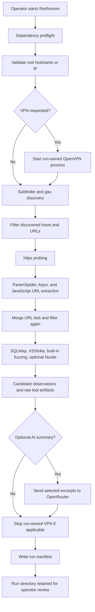

# Architecture and data flow

RedVenom is an interactive Bash orchestrator around separately installed command-line tools. It does not implement a complete web scanner or a network-enforced scope boundary of its own.

## Workflow overview

The exact stages depend on which optional tools are installed and which interactive choices are selected. Nuclei is optional. RedVenom requires the dependencies listed in [Installation](INSTALLATION.md).

## Components and responsibilities

| Component | Responsibility | Important boundary |
| --- | --- | --- |
| `redvenom.sh` | Prompts, orchestration, output paths, VPN lifecycle, and optional AI menu | Executes active checks; not a passive-only workflow |
| `scripts/preflight.py` | Checks required command availability before the interactive workflow | Presence does not prove that every installed tool version or CLI flag is compatible |
| `scripts/validate_target.py` | Normalizes a bare DNS hostname or IP address | Does not determine whether the operator is authorized to test it |
| `scripts/filter_scope.py` | Filters discovered entries to the supplied root and its DNS subdomains, or exact IP match | List-level defense in depth, not a firewall or redirect policy |
| External scanners | Perform discovery, parameter collection, and active tests | Their request volume, redirects, TLS behavior, and output formats remain tool-specific |
| `scripts/parse_nuclei_jsonl.py` | Converts Nuclei JSONL into a candidate TSV | Parser output is an observation, not a confirmed vulnerability |
| `scripts/write_run_manifest.py` | Records run metadata and hashes of generated artifacts | Hashes do not authenticate the manifest or validate findings |
| `scripts/verify_run_manifest.py` | Checks a run directory against its recorded manifest | Integrity check only; see [Verifying a run](VERIFYING_RUNS.md) |

## Trust boundaries and data handling

### Operator input

The target validator accepts a bare hostname or IP. It does not check ownership, engagement scope, or program rules. The operator must confirm that each discovered host, URL, path, and third-party service is explicitly authorized before testing.

### Discovery and scanner output

Discovered hostnames, archived URLs, JavaScript content, and external scanner output are untrusted inputs. The scope filter checks the host in the input list before downstream processing. This does not control DNS changes, redirects followed by external tools, secondary requests made by scanners, or requests to third parties.

### Active network traffic

SQLMap, XSStrike, Nuclei, and built-in payload routines can send state-changing or intrusive requests. Built-in curl calls use TLS certificate verification and bounded connect/total timeouts. Third-party scanners use their own transport and request controls. The current concurrency settings are per-stage limits, not a global request-rate limit or engagement-wide budget.

### Optional external AI

The optional OpenRouter feature sends selected excerpts from local scan output to an external provider. Review the data and confirm disclosure is permitted before enabling it. Do not include credentials, cookies, customer data, or secrets in scan artifacts.

### Local artifacts

Each run is stored below `recon_venom/runs/<timestamp>-<process-id>/`. The shell sets a restrictive umask before creating artifacts. A run manifest records target identity, timing, tool-version strings, relative artifact paths, sizes, and SHA-256 hashes. Treat the directory and manifest as sensitive assessment data.

## What the workflow does not guarantee

- No network-level egress allowlist or guaranteed redirect containment is implemented.
- No true no-network dry-run mode is implemented.
- No global request-rate limiter or engagement-wide request budget is implemented.
- Scanner alerts and built-in string matches are candidate observations that require independent manual verification.
- A run with no candidates does not prove the target is secure.
- A matching manifest hash does not prove that an artifact is accurate, complete, or authentic.

For operating controls and remaining gaps, see [Safety](SAFETY.md) and [Maintenance](MAINTENANCE.md).
